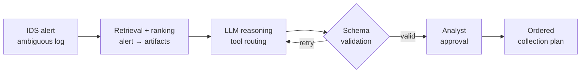

<picture>
  <source media="(prefers-color-scheme: dark)" srcset="assets/banner-dark.svg">
  <source media="(prefers-color-scheme: light)" srcset="assets/banner-light.svg">
  
</picture>

  
  
  
  

<b>Open to new-grad and early-career Backend, Software and AI Engineer roles starting January 2027 · Atlanta, GA · open to relocation</b>

---

I build backend systems that hold up in production, and AI features that can be tested like the rest of the code.

At **CrimsonLogic** I shipped and supported enterprise software: Java and Spring Boot services, SQL Server data models, React and Angular frontends, and CI/CD pipelines, and I was on the hook for it after merge. At the **University of Georgia** I've been taking those habits into AI engineering: retrieval pipelines, agents that call tools, structured outputs that get validated before anyone sees them, and evaluation sets that tell me when a change made things worse.

## Shipped in production

<table>
<tr>
<td width="33%" valign="top">

**30+ production REST/J2EE APIs**

across 8 enterprise workflows in Java, Spring Boot and Hibernate/JPA, with request and response contracts that client teams integrated against directly. I tuned SQL Server queries, stored procedures and indexes on high-volume tables, and traced production incidents across the UI, API and SQL layers.

CrimsonLogic · Software Engineer
</td>
<td width="33%" valign="top">

**22 tables · 9 pipelines · 1 system of record**

As the solo engineer, I built a relational data platform with a 120-field validated intake and live dashboards. It replaced four teams' separate spreadsheets. I gathered requirements from each team, owned the build-vs-buy decision, and trained the staff who use it daily.

University of Georgia · Software Engineering Intern
</td>
<td width="33%" valign="top">

**RAG forensic triage agent**

for Security Operations Centers. It turns an ambiguous IDS alert into a prioritized, schema-validated evidence-collection plan. The pipeline covers retrieval over an alert-to-artifact map, explicit ranking, multi-step LangGraph orchestration, and an analyst approval gate.

M.S. project · code private (university research)
</td>
</tr>
</table>

## Featured open-source projects

Built to show, in public, how I approach the problems I've solved in private codebases. Every repo has tests, CI, and a README that explains the design tradeoffs, not just the setup.

| Project | What it shows | Stack |
|---|---|---|
| **[approval-workflow-service](https://github.com/geethapriya1625/approval-workflow-service)** | Multi-step approval engine with segregation of duties, idempotency keys, optimistic locking, and a transactional outbox to Kafka. It's the kind of contract and approval workflow I built at CrimsonLogic. | Java 21 · Spring Boot 3 · PostgreSQL · Flyway · Kafka · Testcontainers |
| **[redis-rate-limiter](https://github.com/geethapriya1625/redis-rate-limiter)** | Distributed token-bucket rate limiting with an atomic Redis Lua script, a Spring filter with standard `RateLimit` headers, and load-test results measured on real runs. | Java 21 · Spring Boot · Redis · Lua |
| **[llm-eval-harness](https://github.com/geethapriya1625/llm-eval-harness)** | Regression tests for structured-output LLM features: strict schemas, validate-and-repair retries, field-level scoring, baselines, and a CI gate that fails the build when quality drops. | Python · Pydantic · httpx · GitHub Actions |
| **[sql-guard-mcp](https://github.com/geethapriya1625/sql-guard-mcp)** | A read-only SQL MCP server for AI agents. Three independent safety layers (AST guard, read-only connection, time box), column masking, row caps, and an audit log. | Python · MCP SDK · sqlglot · SQLite · PostgreSQL |

## How the triage agent works

The generative step is the small part. Retrieval quality, ranking, and output validation decide whether an AI feature is usable somewhere a confidently wrong answer has a cost.

## Toolbox

| Area | Tools |
|---|---|
| **Languages** | Java · Python · TypeScript · JavaScript · SQL · C# · C/C++ |
| **Backend** | Spring Boot · Spring Security · Hibernate/JPA · REST · Node.js/Express · FastAPI · .NET |
| **Data** | PostgreSQL · SQL Server · MySQL · MongoDB · Redis · Kafka · RabbitMQ |
| **AI** | RAG · LangChain/LangGraph · OpenAI API · tool/function calling · MCP · Pydantic · evals · PyTorch |
| **Frontend** | React · Angular · TypeScript · component libraries · accessible, responsive UI |
| **Cloud & delivery** | Docker · Kubernetes · Jenkins · GitHub Actions · AWS (EC2, S3, Lambda, RDS) · Azure · GCP |
| **Practices** | Code review · TDD with JUnit/Mockito/pytest · production support · RCA · AI-assisted development with human review |

## How I work

- **Reject bad input at the edge.** Validation belongs at the API boundary and the intake form, because cleaning data later costs far more than constraining it at entry.
- **Ownership doesn't end at merge.** Once you're the person paged for a defect, clear boundaries, honest error messages and traceable behavior stop being style preferences.
- **Test the AI like the rest of the code.** A prompt change is a code change. It gets a labeled dataset, a baseline, and a CI gate.
- **AI-assisted, human-reviewed.** I use coding agents daily for refactoring, tests and docs, and I read every generated change before it lands.

## Experience

| Role | Where | When |
|---|---|---|
| Software Engineering Intern | University of Georgia | Aug 2025 – Present |
| Software Engineer | CrimsonLogic, Bangalore | Aug 2022 – Jul 2025 |

**Education:** M.S. Computer Science, University of Georgia (Dec 2026, GPA 3.9) · B.E. Computer Science, Nagarjuna College of Engineering and Technology

---

  If you're hiring for backend or applied-AI work, I'd like to hear about the problem you're solving. 
  <a href="mailto:GeethaPriya.K@uga.edu">GeethaPriya.K@uga.edu</a> · <a href="https://www.linkedin.com/in/kanikireddy">LinkedIn</a> · <a href="https://geethapriya1625.github.io/">Portfolio</a>

